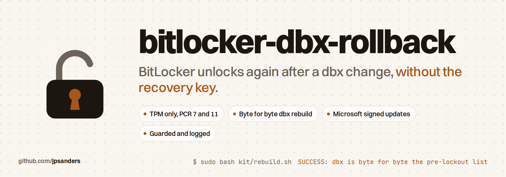

<p align="center">
  <picture>
    <source media="(prefers-color-scheme: dark)" srcset="https://raw.githubusercontent.com/jpsanders/bitlocker-dbx-rollback/main/docs/images/banner-dark.png">
    
  </picture>
</p>

<p align="center">
  <a href="https://github.com/jpsanders/bitlocker-dbx-rollback/actions/workflows/dev.yml"></a>
  <a href="https://github.com/jpsanders/bitlocker-dbx-rollback/releases/latest"></a>
  <a href="https://pypi.org/project/bitlocker-dbx-rollback/"></a>
  <a href="https://www.python.org/downloads/"></a>
  
  
  <a href="https://github.com/jpsanders/bitlocker-dbx-rollback#with-an-ai-agent"></a>
  <a href="https://mypy-lang.org/"></a>
  <a href="https://github.com/jpsanders/bitlocker-dbx-rollback/blob/main/LICENSE"></a>
  <a href="https://github.com/jpsanders/bitlocker-dbx-rollback/stargazers"></a>
</p>

Your Windows laptop suddenly says **"BitLocker needs your recovery key to unlock your drive because Secure Boot
policy has unexpectedly changed"**, and you do not have the key. If the change was to the Secure Boot revocation list
(dbx), this tool can get the TPM to unlock the drive by itself again. It works out exactly which dbx the TPM is
waiting for, proves which Microsoft signed updates rebuild it byte for byte, and writes a guarded script that puts
it back.

It was built to recover a real laptop, and it did: Windows started again with the TPM alone, and the recovery key was
read out and saved.

```sh
uv tool install bitlocker-dbx-rollback
dbx-rollback analyze --efivars efivars/ --dislocker-log bitlocker-info.log --out target-dbx.bin
dbx-rollback plan --factory-dbx factory-dbx.bin --target target-dbx.bin --payloads payloads/
```

## Is this your problem?

It fits when all of these hold:

- The blue BitLocker screen gives the reason **Secure Boot policy has unexpectedly changed**.
- The drive's only protectors are **TPM** and **Numerical Password** (TPM only BitLocker, the Windows default),
  sealed to **PCRs 7 and 11**.
- Something wrote to the firmware's **dbx** from outside Windows. The classic case: an Ubuntu USB stick whose
  `secureboot-db.service` appends Microsoft's revocation list to every PC it boots. `fwupd` dbx updates and BIOS
  updates can do the same.
- The firmware can load its **factory Secure Boot keys**, and its PK, KEK and db are still the factory ones.

If you have the 48 digit recovery key, type it in instead. This tool is for when you cannot.

## How it works

1. **The sealed state.** A TPM only protector seals the volume key to `PolicyAuthValue` then `PolicyPCR(7, 11)`.
   The protector stores the PCR digest the TPM will accept. `analyze` reads it from `dislocker-metadata` output and
   checks the policy really is that shape.
2. **PCR 7 from variables.** Firmware measures SecureBoot, PK, KEK, db and dbx, a separator, then the db entry
   that verified each image. `analyze` replays that for every list boundary of today's dbx and every db entry. Firmware
   only ever appends to dbx, so the sealed dbx is a prefix of today's. One prefix matches.
3. **Rebuild by signed appends.** dbx only accepts additions signed by a KEK. So the firmware's factory keys go back
   first (dbx becomes the factory list), then Microsoft's own signed updates are appended in the order Windows once
   applied them. Firmware drops entries it already has and adds the rest as one new list, so the structure comes back
   exactly. `plan` simulates that and searches for the order that rebuilds the target byte for byte.
4. **Find the missing updates.** `fetch` downloads every uefi.org release from LVFS and every version in
   `microsoft/secureboot_objects`, and collects the files a Windows install kept in `SecureBootUpdates` and `WinSxS`.
   Some updates only ever shipped inside Windows updates; `psf` pulls their patches out of an express package from
   the Microsoft Update Catalog, and `apply-delta` applies them with `msdelta.dll` from a Windows install you own,
   under Wine.
5. **A guarded kit.** `kit` refuses to write anything unless the sequence rebuilds the target in simulation. Its
   `rebuild.sh` runs on the locked machine from a Linux stick, writes only dbx, checks PK, KEK and db first, checks
   every step's size and content, stops at the first difference, can be rerun, logs everything, and has a read only
   `verify` mode for after a reboot.

## Recover a machine

The full walkthrough, with the firmware steps, is in the [manual](https://github.com/jpsanders/bitlocker-dbx-rollback/blob/main/docs/MANUAL.md).
In short:

```sh
# On the locked PC, booted from a Linux stick whose secureboot-db.service is MASKED:
sudo dislocker-metadata -V /dev/nvme0n1p3 > bitlocker-info.log
mkdir efivars && cp /sys/firmware/efi/efivars/{SecureBoot,SetupMode,PK,KEK,db,dbx,dbxDefault}-* efivars/

# Anywhere:
dbx-rollback analyze --efivars efivars/ --dislocker-log bitlocker-info.log --out target-dbx.bin
tail -c +5 efivars/dbxDefault-* > factory-dbx.bin
dbx-rollback fetch --out payloads/ --lvfs --secureboot-objects
dbx-rollback plan --factory-dbx factory-dbx.bin --target target-dbx.bin --payloads payloads/
dbx-rollback kit --efivars efivars/ --factory-dbx factory-dbx.bin --target target-dbx.bin \
  --sequence payloads/A payloads/B ... --out kit/

# On the locked PC: firmware setup, Secure Boot off, clear the Secure Boot keys, load the factory keys,
# Secure Boot on. Then from the stick:
sudo bash kit/rebuild.sh
sudo bash kit/rebuild.sh verify     # after one more reboot
```

When `verify` prints **VERIFIED**, unplug the stick and start Windows. Then save the recovery key:
`manage-bde -protectors -get C:` in an administrator prompt.

## Safety

- Nothing here writes to the encrypted drive or the TPM. The kit writes one firmware variable, dbx.
- Never use **Clear TPM** or a firmware option that resets security settings (on HP: *Restore Security settings to
  Factory Defaults*). That destroys the TPM protector, and with it this route.
- Clearing the Secure Boot keys is only safe when the firmware can load its factory keys afterwards. On the HP
  this was built on, *Load HP Factory Default Keys* becomes selectable only after *Clear All Secure Boot Keys*.
- The recovery key always still works. Nothing in this process can stop it from working.

## No Microsoft binaries

This repository ships code only. Signed dbx updates are downloaded by `fetch` from their public homes (LVFS,
`microsoft/secureboot_objects`, the Microsoft Update Catalog), and `msdelta.dll` comes from a Windows installation you
own. Tests use synthetic data.

## With an AI agent

The repository is a Claude Code plugin: `claude plugin install` it from this repository, and its skill walks an
agent through the analysis with the same stop rules. `dbx-rollback guide` prints the full manual for any agent.

## Install

Python 3.14 or later. `uv tool install bitlocker-dbx-rollback` or `pipx install bitlocker-dbx-rollback`. `fetch
--lvfs` needs `zstd`; the Windows update steps need `wine` and `cabextract`.

`dbx-rollback man --install` makes `man dbx-rollback` work. The source is [`docs/MANUAL.md`](https://github.com/jpsanders/bitlocker-dbx-rollback/blob/main/docs/MANUAL.md).

## Develop

```sh
make init-dev
make checks
```

`make checks` runs isort, black, editorconfig-checker, darglint, flake8, mypy in strict mode, bandit, the man page
check and pytest, the same as CI. See [CONTRIBUTING.md](https://github.com/jpsanders/bitlocker-dbx-rollback/blob/main/CONTRIBUTING.md)
and [AGENTS.md](https://github.com/jpsanders/bitlocker-dbx-rollback/blob/main/AGENTS.md).

## Star history

<a href="https://star-history.com/#jpsanders/bitlocker-dbx-rollback&Date">
  <picture>
    <source media="(prefers-color-scheme: dark)" srcset="https://api.star-history.com/svg?repos=jpsanders/bitlocker-dbx-rollback&type=Date&theme=dark">
    
  </picture>
</a>

## Licence

MIT. Made by [James Phillip Sanders](https://jamesphillipsanders.com).
